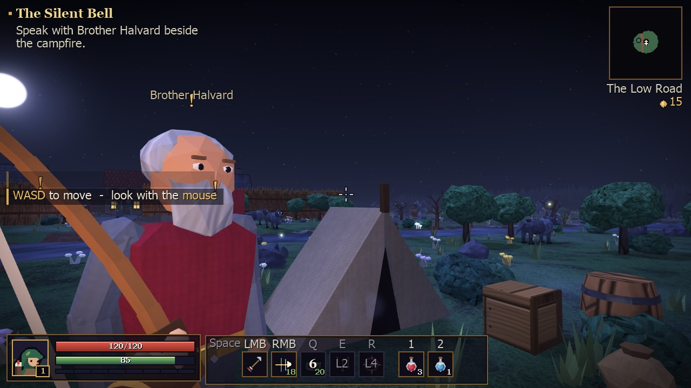
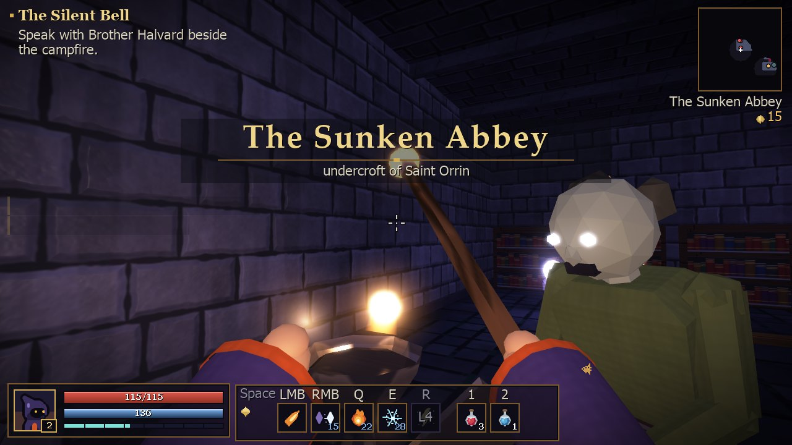
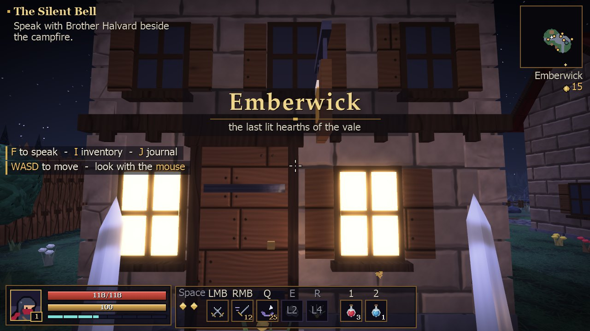
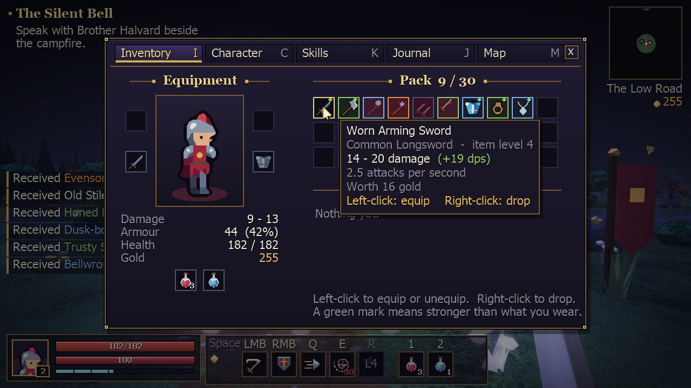
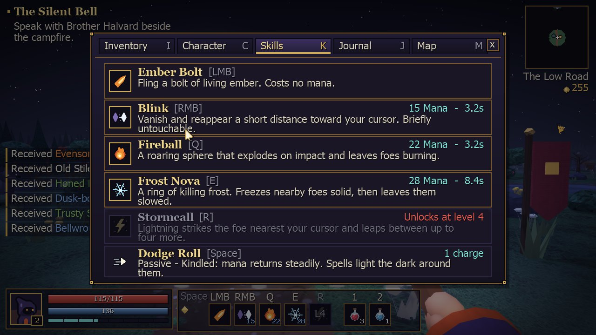

# Vesperfell

A first-person dark-fantasy action RPG for Windows, running on its own small engine written in C# and OpenGL. Four classes, real-time combat, loot, a story that ends in a boss fight, and co-op for up to four players. English and Russian.

**[Download for Windows (v2.0, 0.4 MB)](https://github.com/nexlyy/vesperfell/releases/latest)** · [По-русски](docs/README_RU.txt)



For four hundred years the Vesper Bell rang at the close of every day and kept the Gloam on its own side of the vale. Thirty nights ago it fell silent, and the dusk has not lifted since. You walk the vale through your hero's eyes, fight what came out of the dark and find out who silenced the bell.

| | |
|---|---|
|  |  |
|  |  |

## Running it

Unzip the release anywhere and start `Vesperfell.exe`. It needs Windows 10 or 11 (64-bit) and nothing else: the .NET Framework 4.x it runs on ships with Windows. The 3D view wants a graphics card with OpenGL 3.3; without one the game starts in its 2D view on its own.

The exe isn't code-signed, so SmartScreen may stop it the first time. Click "More info", then "Run anyway".

Switches: `--windowed`, `--fullscreen`, `--mute`, `--3d`, `--2d`.

## What's in it

- A 3D world seen from the hero's eyes: the village of Emberwick, the Thornwood, Mirefen, the Barrowfield, Abbey Rise, the Ashen Fields and the abbey undercroft down to the Bell Crypt. There is also an overhead camera, and the original 2D view is still there as an option.
- Four classes with five abilities each and a dodge roll: the Warrior (Fury), the Mage (Mana), the Rogue (Energy) and the Ranger (Focus).
- Combos, blocking, crits, knock-back and status effects (stun, root, burn, poison, bleed, freeze); elite enemies, a knight in the barrows and a final boss.
- Loot in four rarities, levels 1 to 15, attribute points, a smith and a herbalist, side quests, secrets, a journal, a world map and a minimap.
- Music and 77 sound effects synthesised at startup. There are no audio files at all; the art is generated in code as well.
- Co-op over TCP for up to four players, with shared quests and world, and loot rolled separately for each hero.
- English and Russian, switchable at any time.

## Controls

| Key | Action | Key | Action |
|---|---|---|---|
| W A S D | Move | Mouse | Look and aim |
| Left mouse | Basic attack (hold) | Right mouse | Class secondary |
| Q / E / R | Abilities | Space | Dodge roll |
| F | Interact / talk | 1 / 2 | Health / spirit draught |
| I or Tab | Inventory | C | Character |
| K | Skills | J | Journal |
| M | Map | Esc | Pause / close |
| F11 | Fullscreen | Enter | Party chat |

## Co-op

The host presses Esc in a game and picks **Host Co-op**; the game then lists the addresses friends can use. Friends choose **Join Game** on the title screen, enter that address and pick a class. On a home network use the 192.168.x.x or 10.x.x.x address. Over the internet, forward TCP port 27015 to the host or put everyone on a virtual LAN such as Radmin VPN, ZeroTier or Tailscale. Guests are brought up to the host's level, and the journey is saved in the host's game.

## Building

`build.bat` compiles everything with the C# compiler that comes with Windows (`csc.exe` from .NET Framework 4.x), so there is no SDK, NuGet or engine to install. The output is `build\Vesperfell.exe`. The code sticks to C# 5 because that is what this compiler understands.

| Folder | What lives there |
|---|---|
| `src/Gl` | OpenGL 3.3 renderer: world geometry, character rigs, props, materials, effects, the first-person view model |
| `src/Game` | World generation, combat, enemies, items, quests, dialogue, saving |
| `src/UI` | HUD, windows and menus |
| `src/Core` | Maths, software surfaces, fonts, interface batching, localisation |
| `src/Art` | Procedural sprites and textures |
| `src/Audio` | Synthesiser, music and sound effects |
| `src/Net` | Co-op networking |
| `src/Platform` | The Win32 window, OpenGL context and input |
| `src/Tools` | Self-test and debugging dumps |

## Tests

The game tests itself:

```
Vesperfell.exe --selftest <folder> all        # 301 checks
Vesperfell.exe --selftest <folder> ru:all     # the same in Russian
Vesperfell.exe --smoke <folder> --3d          # real window, first person (add --top for overhead, or use --2d)
Vesperfell.exe --tour <folder> mage           # scripted walk through every area and window, with screenshots
```

The self-test plays all four classes and every ability, runs the whole main quest to the ending, renders the music and sound offline to check levels, and starts two game instances that play co-op over a real TCP connection. All 301 checks pass in both languages for v2.0.

## Known limitations

- It's a demo: one vale, one main quest and its side quests.
- Keyboard and mouse only. No gamepad, no key rebinding.
- Co-op has been tested on one PC, not across the internet. There's no server browser and no NAT punch-through.
- The 3D view needs OpenGL 3.3, so over Remote Desktop or in some virtual machines the game drops to 2D.

## License

MIT
